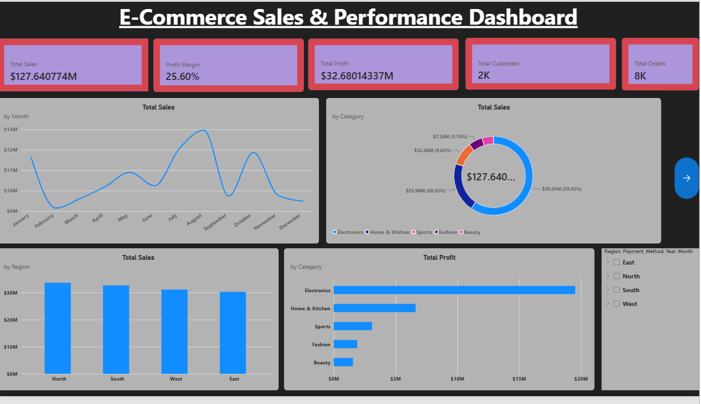

# E-Commerce Sales Analysis Dashboard | Power BI

## 1. Project Overview
This project focuses on analyzing E-Commerce sales data using Microsoft Power BI. It provides an interactive dashboard to understand sales performance and business trends.

## 2. Project Objectives
- Analyze overall sales performance.
- Identify sales trends and patterns.
- Understand business performance.
- Create interactive visualizations.
- Support data-driven decision-making.

## 3. Tools & Technologies
- Microsoft Power BI
- Power Query
- DAX
- Data Cleaning
- Data Visualization

## 4. Project File
**Ecommerce_Sales_Dashboard.pbix**

The project file can be opened using Microsoft Power BI Desktop.

## 5. Key Learnings
- Data cleaning and transformation.
- Creating interactive dashboards.
- Data analysis and visualization.
- Understanding business insights.

## 6. Author
Data Analytics Portfolio Project

## 7. Dashboard Preview

